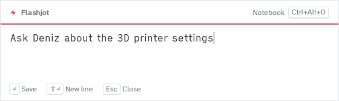
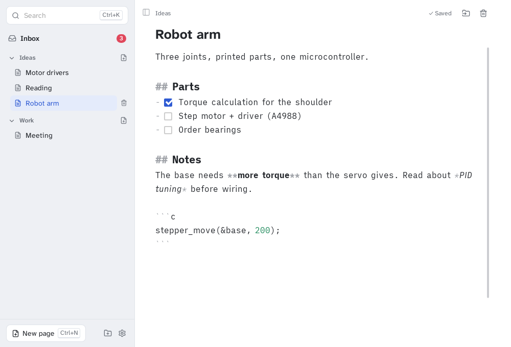
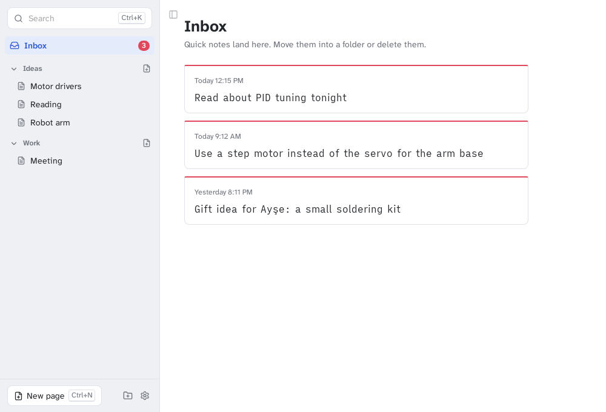
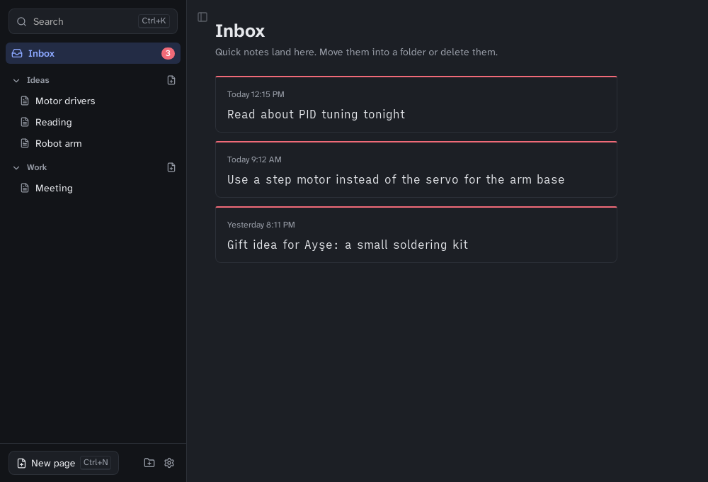

<p align="center">
  
</p>

<h1 align="center">Flashjot</h1>

<p align="center">
  Press a shortcut, write the idea down, press Enter, and you're back to work.<br>
  A small notebook for Linux, Windows and macOS. Notes are plain Markdown files.
</p>

<p align="center">
  
</p>

## Why

Ideas show up at bad times: in the middle of a build, a meeting, or a sentence. Opening a full note app breaks your flow, and by the time it has loaded the idea is gone. Flashjot keeps a capture box one shortcut away. Notes you take that way land in an **Inbox**, and later you can file them into folders in the **notebook**.

## Features

- **Quick box** (`Ctrl+Alt+N`, `⌘⌥N` on macOS). Opens instantly on the monitor your mouse is on. `Enter` saves, `Shift+Enter` adds a new line, and `Esc` closes it **while keeping your draft**.
- **Notebook** (`Ctrl+Alt+D`). Folders, pages, a Markdown editor with live styling and clickable `- [ ]` checkboxes, and full-text search (`Ctrl+K`).
- **Inbox**. Quick notes appear as cards. Move one into a folder with `M` and it gets a title from its first line. Delete with `Del`, then undo if you change your mind.
- **Plain files.** Each note is a `.md` file in `Documents/Flashjot`. Open them with Obsidian, VS Code, `grep` or git. If Flashjot disappears, your notes stay readable.
- **Safe writes.** Every save goes to a temporary file first and is then swapped in, so a crash or power cut never leaves a half-written note.
- **Keyboard first.** Everything has a shortcut, and you can change the global ones in Settings.
- **Light and dark themes** follow your system. The interface is in English and Turkish.
- **Small.** It is built with [Tauri](https://tauri.app), so it uses the system web view instead of bundling a browser.

<p align="center">
  
</p>

<p align="center">
  
  
</p>

## Install

Download the file for your system from [Releases](https://github.com/mftnakrsu/flashjot/releases):

| System | File |
|---|---|
| Ubuntu, Debian, Pardus, Mint | `Flashjot_x.y.z_amd64.deb`, install with `sudo apt install ./Flashjot_*.deb` |
| Fedora, openSUSE | `Flashjot-x.y.z-1.x86_64.rpm` |
| Any Linux | `Flashjot_x.y.z_amd64.AppImage`. Run `chmod +x` on it, then start it |
| Windows 10/11 | `Flashjot_x.y.z_x64-setup.exe` or `.msi` |
| macOS (Apple Silicon / Intel) | `Flashjot_x.y.z_aarch64.dmg` / `_x64.dmg` |

Flashjot starts in the tray. The notebook opens the first time you launch it from the app menu.

> **macOS:** the app is not notarized yet. The first time, right-click it and choose **Open**.
> **Windows:** SmartScreen may warn about an unknown publisher. Choose **More info → Run anyway**.

## Shortcuts

| Where | Keys | Action |
|---|---|---|
| Anywhere | `Ctrl+Alt+N` | Open the quick box (press again to hide it) |
| Anywhere | `Ctrl+Alt+D` | Open the notebook |
| Quick box | `Enter` / `Shift+Enter` / `Esc` | Save / New line / Close and keep draft |
| Notebook | `Ctrl+K` | Search |
| Notebook | `Ctrl+N` | New page next to the current one |
| Notebook | `Ctrl+B` | Show or hide the sidebar |
| Notebook | `Ctrl+M` | Move the current page or note |
| Notebook | `Ctrl+,` | Settings |
| Inbox | `↑` `↓` / `Enter` / `M` / `Del` | Select / Open / Move / Delete |

On macOS, use `⌘` instead of `Ctrl`.

### Linux on Wayland

Wayland does not let apps register global shortcuts themselves yet. Add two custom shortcuts in your desktop's keyboard settings instead:

| Name | Command |
|---|---|
| Flashjot quick note | `flashjot --quick` |
| Flashjot notebook | `flashjot --notebook` |

If the app is already running, these commands reuse it, so the quick box still opens instantly. On X11, Windows and macOS this step is not needed.

## Where are my notes?

```
Documents/Flashjot/
├── Inbox/                 ← quick notes, one file each (2026-10-19-143205.md)
├── Ideas/
│   └── Robot arm.md
├── Work/
│   └── Meeting.md
└── .trash/                ← deleted notes; empty it whenever you like
```

You can pick another folder in **Settings**. Settings are stored in a small JSON file in your system's app config folder.

## Build from source

Requirements: [Rust](https://rustup.rs) 1.90+, Node.js 20+, and the [Tauri prerequisites](https://v2.tauri.app/start/prerequisites/) for your OS. On Debian, Ubuntu or Pardus:

```sh
sudo apt install libwebkit2gtk-4.1-dev build-essential curl wget file libxdo-dev libssl-dev libayatana-appindicator3-dev librsvg2-dev
```

Then:

```sh
git clone https://github.com/mftnakrsu/flashjot && cd flashjot
npm install
npm run tauri dev      # run with hot reload
npm test               # Rust unit tests for the note store and settings
npm run check          # Svelte and TypeScript checks
npm run tauri build    # installers in src-tauri/target/release/bundle/
```

How the code is organized:

| Path | What it does |
|---|---|
| `src-tauri/src/store.rs` | Reads and writes notes on disk. Has no Tauri dependency and is fully unit-tested |
| `src-tauri/src/settings.rs` | Settings file with defaults |
| `src-tauri/src/windows.rs` | Quick box and notebook windows, focus handling |
| `src-tauri/src/shortcuts.rs`, `tray.rs` | Global shortcuts and the tray menu |
| `src-tauri/src/commands.rs` | The commands the UI calls |
| `src/routes/quick/` | Quick box UI |
| `src/routes/notebook/`, `src/lib/components/` | Notebook UI |
| `src/lib/editor/` | CodeMirror Markdown editor |
| `src/lib/i18n.svelte.ts` | Interface text. Add a language here |

## Roadmap

- [ ] Optional SQLite storage backend for very large notebooks (behind the same `store` interface)
- [ ] Wayland global shortcuts through the XDG GlobalShortcuts portal
- [ ] Watch the notes folder and reload pages edited in other apps
- [ ] Tags and `#hashtags`
- [ ] Images and attachments
- [ ] Sync, using any folder-sync tool for now; built-in later
- [ ] More languages (contributions welcome, see `src/lib/i18n.svelte.ts`)
- [ ] Signed and notarized macOS and Windows builds

## Türkçe

Flashjot, ani fikirleri kaybetmemek için yapılmış bir not uygulamasıdır. Her yerde `Ctrl+Alt+N` ile küçük bir kutu açılır; yaz, `Enter`'a bas, işine dön. `Ctrl+Alt+D` ile açılan defterde notlarını klasörlere ayırabilir, arayabilir ve düzenleyebilirsin. Notlar `Belgeler/Flashjot` klasöründe düz `.md` dosyaları olarak durur. Arayüz dili sistem diline göre otomatik seçilir; Ayarlar'dan değiştirilebilir. Pardus ve Ubuntu için `.deb` paketini [Releases](https://github.com/mftnakrsu/flashjot/releases) sayfasından indirebilirsin.

## Contributing

Issues and pull requests are welcome. See [CONTRIBUTING.md](CONTRIBUTING.md).

## License

[MIT](LICENSE). The bundled fonts, Atkinson Hyperlegible Next and iA Writer Quattro, are under the SIL Open Font License. Icons are from [Lucide](https://lucide.dev) (ISC).
